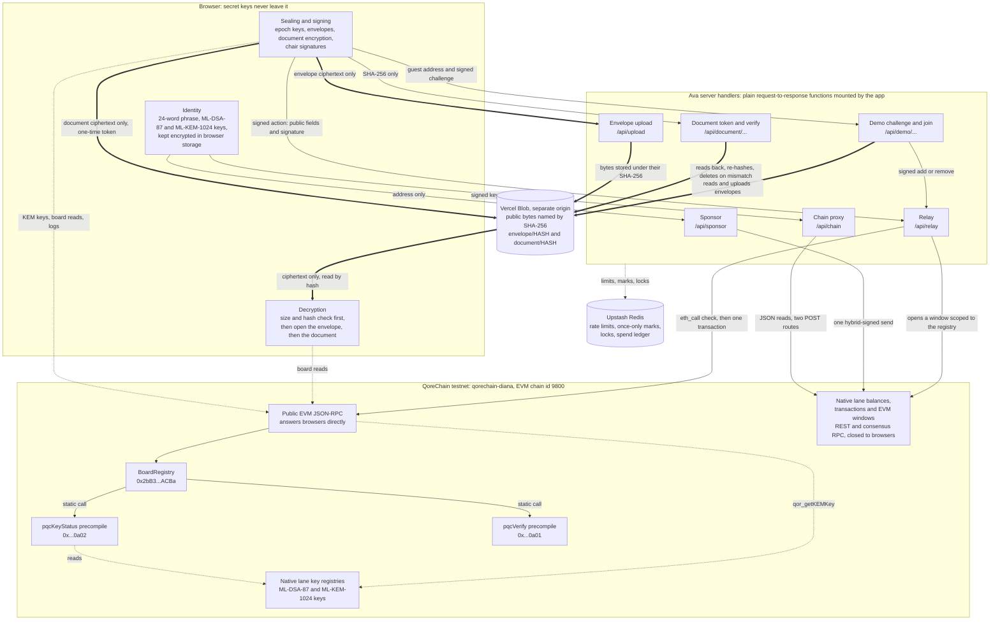
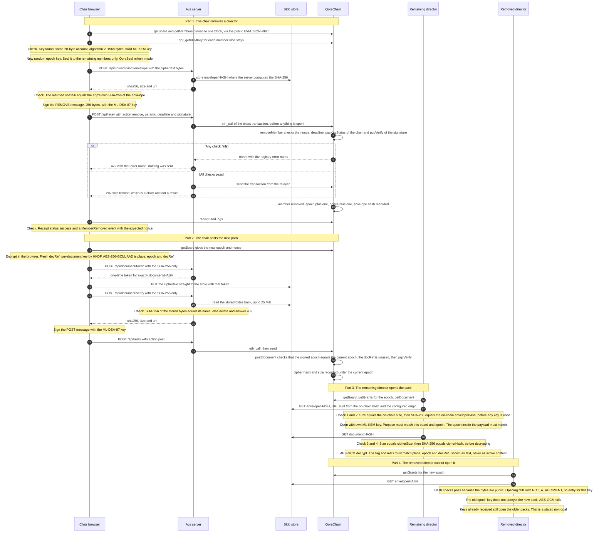
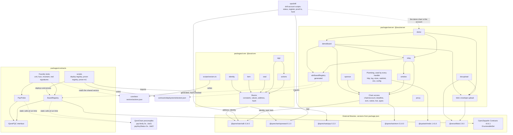

# Ava architecture

This page explains how Ava works, from the plain idea down to the exact calls the web app makes. Each section opens in plain English and gives the exact detail after it. Every fact here was read from the code in this repository, from the saved deployment records, or from a live read of the QoreChain testnet on 17 Nov 2026.

Contents

1. What Ava is
2. System overview (diagram 1)
3. The main sequence (diagram 2)
4. Modules and contracts (diagram 3)
5. Deployed on testnet
6. The interface for the web app
7. Costs
8. Limits and non-goals

Words used on this page

- Chair: the one account that controls a board. Every change to a board needs the chair's quantum-safe signature.
- Director: any member of a board. A director can read the board's documents.
- Pack: an encrypted document posted to a board.
- Epoch: a numbered version of a board's secret key. Removing a director starts a new epoch with a new key, so later packs are closed to the person who left.
- Envelope: a small encrypted package that hands an epoch key to the directors it is sealed to.
- Relayer: a server account that pays the network fee to submit the chair's signed changes. It has no authority of its own.
- Sponsor: a server account that gives each new identity a little testnet QOR so it can register its keys.
- ML-DSA-87: the quantum-safe signature scheme (FIPS 204) that authorises every change. ML-KEM-1024: the quantum-safe key exchange used to seal an epoch key to a director.

## 1. What Ava is

Ava is a private board room for company directors, built on the QoreChain testnet. Every pack is encrypted in the director's own browser before it goes anywhere, and the keys are handed out through QoreChain's quantum-safe key registry, so no server, storage host or the chain itself can read a pack. The chair adds and removes directors with one quantum-safe signature per change, and the chain itself checks that signature, so removing a director really does close every pack posted afterwards to that person.

## 2. System overview

Plain English: the browser does all the secret work. The server only passes along public data, hashes, signatures and scrambled bytes, and it spends its own small budgets to help: it pays fees for the chair, funds new identities and keeps counters. The chain is the single record of who is on each board and what the next legal change is.

Diagram 1 uses three kinds of arrow. A thick arrow carries ciphertext only: bytes that are unreadable without a key. A normal arrow carries public data, hashes, signatures or addresses. A dotted arrow is a read, or a pointer to shared state.



What the diagram shows, in order of importance:

- Secrets stay in the browser. The recovery phrase, the ML-DSA-87 and ML-KEM-1024 secret keys, every epoch key and the passphrase are never sent to any server. Every arrow leaving the browser carries public data, a hash, a signature, an address or ciphertext.
- Ciphertext travels only on the thick arrows. Envelopes go through the server so it can hash what it receives. Documents are too large for the host's request limit, so they go from the browser straight to the blob store (section 8).
- The blob store is on a separate registrable domain from the app and serves every object as `application/octet-stream`, as an attachment, with `nosniff`. It holds nothing that can run as the app.
- The browser reads key registrations and board state straight from the public EVM JSON-RPC. Our server is never on the path that tells a chair which ML-KEM key belongs to a director.
- The chain checks the chair's signature itself. BoardRegistry static-calls two precompiles: `pqcKeyStatus` returns the key registered for the chair, and `pqcVerify` checks the signature against it. The relayer that submits the transaction grants nothing.
- Nothing security-relevant lives in server memory. Rate limits, once-only marks, locks and the relayer's spend ledger sit in Upstash.

How the parts run:

| Part | Runs on | Job | Sees plaintext? |
|---|---|---|---|
| Browser app | The user's device | Holds keys, seals and opens envelopes, encrypts and decrypts packs, signs chair actions | Yes, for boards the user belongs to |
| Server handlers | The app's hosting, as serverless functions | Proxy chain reads, store and hash ciphertext, relay signed actions, fund new identities, run the demo board | No: ciphertext, hashes, signatures and addresses only |
| Upstash Redis | Managed service | Shared counters, marks and locks | No |
| Vercel Blob | Managed service, own origin | Public ciphertext named by SHA-256 | No |
| QoreChain testnet | Public network | Key registries, BoardRegistry, signature checks | No |

The server code is `packages/server`. Each handler takes a web `Request` and a small context (client IP as the host reports it, the clock, the shared store) and returns a web `Response`. The Next.js app mounts them. `packages/server/scripts/dev-server.ts` mounts the same handlers locally on 127.0.0.1:8787 for trying them against the live testnet.

## 3. The main sequence

Plain English: a chair removes a director. The chair's browser makes a fresh key, locks it for the directors who remain, signs the removal, and the chain checks the signature and moves the board to a new epoch. The chair then posts the next pack under the new key. The remaining director opens it. The removed director cannot, because the new key was never sealed to them, and their old key does not fit the new pack.



Where each check happens:

| Check | Where it runs | What is compared | If it fails |
|---|---|---|---|
| Chair signature | BoardRegistry, inside every write | `pqcKeyStatus(chair)` must say registered, algorithm 1, possession proven, 2,592-byte key. `pqcVerify` must accept the 4,627-byte signature over the 256 bytes the contract builds itself | Revert `NoPqcKey`, `WrongAlgorithm`, `PossessionNotProven`, `BadKeyLength`, `BadSignature` or `PrecompileUnavailable` |
| Replay, order and expiry | BoardRegistry | The nonce inside the signed message must equal the stored nonce. The deadline must be between now and one hour ahead. Epoch moves must be exactly plus one | Revert `BadSignature` (replayed nonce), `DeadlineExpired`, `DeadlineTooFar`, `WrongEpoch` |
| Same check before spending | Relay, `eth_call` of the exact transaction | The contract is the check, so the relay has no second signature checker | 422 with the registry's error name |
| Envelope upload hash | Server, `handleUpload` | The server hashes the bytes it received and names the blob by that hash. Any name from the client is ignored | Not applicable: the name is derived, not trusted |
| Document upload hash | Server, `handleDocumentVerify` | SHA-256 of the stored bytes equals the name the token allowed | The blob is deleted and the answer is 409 `hash_mismatch` |
| Envelope hash before opening | Any reader (chair, director, demo bot) | Size, then SHA-256, against `getGrants` | `EnvelopeError` or `HashMismatch`, no key touched |
| Document hash before decrypting | Any reader | Size, then SHA-256, against `getDocument` | `DocumentError` or `HashMismatch`, no key touched |
| Recipient key is genuine | Any sealer | Key found, answered for the same 20 bytes, algorithm 2, 1,568 bytes, passes `validateMlkemPublicKey` | `KemKeyUnavailable`, the seal stops |
| Envelope belongs here | QoreSeal open | The purpose string `ava/<place>/<epoch>` and the epoch in the payload | `DECRYPTION_FAILED` or `EnvelopeError` |
| Pack belongs here | AES-256-GCM | Tag over the ciphertext plus the AAD (place, epoch, docRef) | `DocumentError` |
| Relay answer is a claim | Chair's browser | Receipt status and the registry event with the expected nonce | The screen says pending |
| Guest challenge (demo board only) | Server, `handleDemoJoin` | The guest's ML-DSA-87 signature over bytes the server rebuilds from its own record, checked against the key `pqcKeyStatus` returns | 403 `bad_signature` or `no_proven_key` |

## 4. Modules and contracts

Plain English: there are four pieces of code. `packages/core` is the one library that builds the signed bytes, checks addresses and hashes, and seals and opens keys, so the browser, the server and the contract tests all agree on every byte. `packages/server` is the set of handlers. `packages/contracts` is the on-chain registry and its proofs. `ops/drill` is a separate set of scripts for the account entered in the Q-Day Drill, which the demo board uses as its chair.



What each piece holds:

| Piece | What it is | Main files |
|---|---|---|
| `packages/core` | The shared library. Builds the exact signed bytes, decodes every address one way, hashes raw bytes, seals and opens epoch keys, encrypts and decrypts packs, reads ML-KEM keys from the chain. Entry point: `packages/core/src/index.ts` | `actions.ts`, `sign.ts`, `seal.ts`, `kem.ts`, `identity.ts`, `address.ts`, `hash.ts`, `constants.ts` |
| `packages/server` | The handlers: chain proxy, envelope upload, direct document upload tokens and verification, relay, window keeper, sponsor, demo bot. Entry point: `packages/server/src/index.ts` | `proxy.ts`, `blob.ts`, `docupload.ts`, `relay.ts`, `window.ts`, `sponsor.ts`, `demo.ts`, `demoBoard.ts`, `store.ts`, `ratelimit.ts`, `config.ts` |
| `packages/contracts` | `BoardRegistry` (every board in one immutable contract), `PqcProbe` (the first end-to-end proof of the two precompiles), the interface `IQorePQC`, the Foundry tests and the live proof scripts | `src/BoardRegistry.sol`, `src/PqcProbe.sol`, `src/interfaces/IQorePQC.sol`, `scripts/prove-registry.ts` |
| `ops/drill` | Scripts for the throwaway account entered in the Q-Day Drill: create it, register its keys, send the drill-day proof transaction, fund other accounts. No other package imports it | `src/status.ts`, `src/register.ts`, `src/proof-tx.ts`, `src/fund.ts` |

Two links keep the pieces honest:

- The Solidity tests and the TypeScript tests both produce the same bytes from one file, `packages/core/test-vectors/actions.json`, written by `packages/core/scripts/vectors.ts` and read by `packages/contracts/test/BoardRegistryVectors.t.sol`.
- `packages/server/src/abi/boardRegistry.ts` is generated by `packages/server/scripts/gen-abi.ts` from the compiled contract. The script refuses to write it unless the build's runtime code hash equals the one recorded in `testnet.json`, so the server only ever speaks the deployed ABI.

## 5. Deployed on testnet

Network: `qorechain-diana` (native chain id), EVM chain id 9800. Record: `packages/contracts/deployments/testnet.json`.

| Contract | Address | Deploy transaction | Block | Deploy gas |
|---|---|---|---|---|
| BoardRegistry | `0x2bB34f60B29C7bC10f7ECC0B5050329E808DAcBa` (`qor19we57c9jn3auzrm7es94q5pjn6qgmt96qe46x0`) | `0xc2e8a6dd43ba9e144967ece917213a0e8cffbc47e0fe38b1e7cbf7b0e0f7eaa1` | 10235963 | 2,490,970 |
| PqcProbe | `0x624b5C35E3665eB9ade6d75BBbca1218a09E00D1` | `0x9fd375c4c948296537ab4419683740f15f4fc71bd7dcaa5b6742d92c12c3d495` | 10181860 | 501,447 |

Both deploy receipts were read from the public EVM JSON-RPC on 17 Nov 2026 and show status success. The deploy gas figures come from those receipts.

BoardRegistry build record: Solidity `0.8.38+commit.1835d247`, EVM version `prague`, optimizer 200 runs, OpenZeppelin Contracts v5.6.1. Its runtime code hash is `0x157b97bfe8fdc2477a2326a26cee20683bf25ca44a96f98ee5c233745f844a9b`. On 17 Nov 2026 the code returned by `eth_getCode` at that address (11,274 bytes) hashed to exactly that value. The server holds the same hash as `REGISTRY_CODE_KECCAK` in `packages/server/src/config.ts`.

The registry has no owner, no admin, no pause, no upgrade path and accepts no value. Nobody, the deployer included, can change a board except its chair, and only by signature.

PqcProbe is a small contract that records a digest only when the signer's registered ML-DSA-87 key signed it. It was the first proof that a deployed contract can check a real post-quantum signature with the precompiles. The product uses BoardRegistry.

Source verification: Sourcify does not list chain 9800 (a lookup on 17 Nov 2026 answered `unsupported_chain`), and the explorer at https://explore.qore.network offered no source submission when the registry was deployed. To check the contract yourself, build `packages/contracts` with the pinned compiler and compare the keccak256 of the runtime code with the hash above.

Endpoints used by the code:

| Name | URL | Used by |
|---|---|---|
| Public EVM JSON-RPC | https://evm-testnet.qore.host | Browsers directly, and the server |
| REST | https://api-testnet.qore.host | The server and its proxy only. It sends no CORS headers, so browsers cannot call it |
| Consensus RPC | https://rpc-testnet.qore.host | The server only |
| Explorer | https://explore.qore.network (switch to Testnet) | People |

Precompiles inside the EVM lane: `pqcVerify` at `0x0000000000000000000000000000000000000a01`, `pqcKeyStatus` at `0x0000000000000000000000000000000000000a02`.

### Role accounts

Public addresses only. Each role is a separate account, and each holds only what its job needs. Recovery phrases live in server secrets or local git-ignored files and never in the repository.

| Role | Address | What it may do | What it cannot do |
|---|---|---|---|
| Deployer | `qor13gmaduk6r79q0utnt3tgcfs3ypwe86tn8292fq` / `0x8A37d6f2DA1F8a07f1735c568C2611205d93e973` | Deployed PqcProbe and BoardRegistry. Sent the transactions of the live proof run (section 7) | Control any board. The registry has no owner role |
| Relayer | `qor1xss2hc8w33twyssdzejd7hepmd3qxgywvplhff` / `0x3420ABE0Ee8c56e2420D1664dF5F21db6203208e` | Pay the fee to submit chair-signed actions to the registry, through one EVM window scoped to the registry alone (40 transactions and 12,000 blocks per window, at most 8 QOR a day) | Act as a chair, move QOR, or call any other contract. If its window is spent outside its own recorded sends, the server halts it for the rest of that UTC day and closes the window |
| Sponsor | `qor1cwula4nakmmkqvns5r4q49gnwfgvd6ln5yrxuf` / `0xc3B9fEd67Db6f7603270a0eA0a95137250c6Ebf3` | Send each eligible new identity 0.25 QOR once, by one hybrid-signed send. At most 100 sends and 25 QOR a day | Send EVM transactions or touch a board. It refuses contract addresses, addresses that already hold a post-quantum key, and addresses holding 0.25 QOR or more |
| Demo chair | `qor1g7rde5fszsedm7hktcxs389aa7nve63y4hpfwy` / `0x4786dCd1301432DDFaF65e0d089CbDEFA6ccEa24` | Chair of the public demo board only. Admits a guest after the guest signs a fresh challenge, and removes guests six hours after admission | Sign anything else. It is the Q-Day Drill account, so the organisers hold its classical key from 18 Nov 2026. The ML-DSA-87 key kept in server secrets is what protects it |

State on 17 Nov 2026, read from the testnet REST: the relayer and sponsor addresses are set up in the server configuration, but on chain they hold no QOR and have no registered key yet. They are funded and registered after the drill, from 19 Nov 2026 (the demo board seeding script refuses to run before that date).

## 6. The interface for the web app

### 6.1 Where the browser talks

| Destination | What for | Notes |
|---|---|---|
| Ava's own server, `/api/...` | Chain reads that browsers cannot make, uploads, relay, sponsor, demo board | Same origin. No CORS headers are ever set. Every answer is JSON |
| Public EVM JSON-RPC, https://evm-testnet.qore.host | KEM keys, board reads, logs, receipts | Answers browsers directly (`access-control-allow-origin: *` on a preflight, checked 17 Nov 2026). Never routed through Ava's server |
| Blob origin, from configuration | Read ciphertext by hash. Write a document with a one-time token | A separate registrable domain. The browser builds every read URL itself from the on-chain hash |

Every server answer carries `content-type: application/json`, `x-content-type-options: nosniff` and `cache-control: no-store`. A refusal is `{ "error": "<code>" }`, where the code is a short word this package chose, never an echo of the input or of an upstream message. Refusals for rate limits and busy locks also carry `retry-after` in seconds.

### 6.2 BoardRegistry reads

Call these with `eth_call` on the public EVM JSON-RPC. The ABI is `packages/server/src/abi/boardRegistry.ts`. In viem, `uint64` and `uint256` come back as `bigint`, and `uint8` and `uint32` as `number`.

| Function | Returns |
|---|---|
| `boardCount() returns (uint256)` | How many boards exist. Boards are numbered from 1, so this is also the newest id |
| `createNonces(address chair) returns (uint64)` | The nonce a chair's next `createBoard` signature must cover |
| `exists(uint256 boardId) returns (bool)` | True for 1 to `boardCount` |
| `boardIdOf(bytes32 boardRef) returns (uint256)` | The board that holds this reference, or 0 |
| `getBoard(uint256 boardId) returns (Board memory)` | See below. Reverts `UnknownBoard` |
| `isMember(uint256 boardId, address account) returns (bool)` | True only for a current member. Never reverts |
| `getMembers(uint256 boardId) returns (address[] memory)` | Current members, chair included, at most 64, in no meaningful order. Reverts `UnknownBoard` |
| `getGrants(uint256 boardId, uint64 epoch) returns (Grant[] memory)` | Every envelope ever recorded for that epoch, in landing order. The first is the `ROTATE` envelope that opened the epoch. Empty for an epoch not reached |
| `getDocument(uint256 boardId, uint256 docId) returns (Document memory)` | One posted pack. Reverts `UnknownBoard` or `UnknownDocument` |
| `actionMessage(uint8 action, uint256 boardId, bytes32 paramsHash, uint64 nonce, uint64 deadline) returns (bytes memory)` | The exact 256 bytes to sign. The app builds these bytes itself with `@ava/core`; this read exists so a test can compare |

Shapes:

```solidity
struct Board {
    address chair;
    bytes32 boardRef;     // 32 random bytes the chair picked, the board's identity for all encryption
    uint64 epoch;         // starts at 0, goes up by exactly one
    uint64 nonce;         // the nonce the chair's next signature must cover, shared by every action
    uint32 memberCount;   // 1 to 64
    uint32 documentCount; // also the next document id
}
struct Grant {
    bytes32 envelopeHash; // SHA-256 of the exact envelope bytes in the blob store
    uint32 envelopeSize;
    uint8 mode;           // 1 ROTATE: sealed to every member. 0 SEAL_CURRENT: sealed to one member
    address member;       // the one recipient for SEAL_CURRENT, address(0) for ROTATE
}
struct Document {
    bytes32 docRef;       // 32 random bytes the key and AAD are bound to
    bytes32 cipherHash;   // SHA-256 of the exact ciphertext bytes
    uint64 cipherSize;
    uint64 epoch;         // the epoch whose key encrypted it
    uint64 postedAt;      // block timestamp
}
```

Read `getBoard` and `getMembers` at the same block number, as `liveDemoChain` does in `packages/server/src/demoBoard.ts`. A key sealed from a stale member list could reach the wrong people. Every action moves the nonce, so a rotation signed from a stale view reverts instead of landing.

Constants readable on the contract: `DOMAIN_TAG`, `CREATE` 1, `ADD` 2, `REMOVE` 3, `ROTATE` 4, `POST` 5, `TRANSFER` 6, `MODE_SEAL_CURRENT` 0, `MODE_ROTATE` 1, `MAX_MEMBERS` 64, `MAX_ENVELOPE_SIZE` 110,000, `MAX_CIPHER_SIZE` 26,214,400, `MAX_DEADLINE_AHEAD` 3,600. The same values are in `packages/core/src/constants.ts`.

Events, for reading history with `eth_getLogs` filtered to the registry address:

| Event | Fields (indexed fields marked) |
|---|---|
| `BoardCreated` | `uint256 indexed boardId, address indexed chair, bytes32 boardRef, uint64 createNonce` |
| `EnvelopeGranted` | `uint256 indexed boardId, uint64 indexed epoch, bytes32 envelopeHash, uint32 envelopeSize, uint8 mode, address member, uint64 nonce` |
| `MemberAdded` | `uint256 indexed boardId, address indexed member, uint64 epoch, uint8 mode, uint64 nonce` |
| `MemberRemoved` | `uint256 indexed boardId, address indexed member, uint64 newEpoch, uint64 nonce` |
| `EpochRotated` | `uint256 indexed boardId, uint64 indexed newEpoch, uint64 nonce` |
| `DocumentPosted` | `uint256 indexed boardId, uint256 indexed docId, bytes32 docRef, uint64 epoch, bytes32 cipherHash, uint64 cipherSize, uint64 nonce` |
| `ChairTransferred` | `uint256 indexed boardId, address indexed from, address indexed to, uint64 nonce` |

Event order inside one transaction: `createBoard` emits `BoardCreated`, then `EnvelopeGranted` (epoch 0). `addMember` emits `MemberAdded`, then `EpochRotated` (rotate mode only), then `EnvelopeGranted`. `removeMember` emits `MemberRemoved`, `EpochRotated`, `EnvelopeGranted`. `rotateEpoch` emits `EpochRotated`, `EnvelopeGranted`. `postDocument` emits `DocumentPosted`. `transferChair` emits `ChairTransferred`.

Registry refusals, as custom error names: `UnknownBoard`, `UnknownDocument`, `NoPqcKey`, `WrongAlgorithm`, `PossessionNotProven`, `BadKeyLength`, `PrecompileUnavailable`, `BadSignature`, `DeadlineExpired`, `DeadlineTooFar`, `WrongEpoch`, `BadMode`, `AlreadyMember`, `NotMember`, `ChairCannotLeave`, `BoardFull`, `ZeroAddress`, `ZeroHash`, `BadEnvelopeSize`, `BadCipherSize`, `DocRefUsed`, `BoardRefUsed`, `SameChair`.

### 6.3 Writes: everything goes through the relay

The browser never sends a registry transaction. It signs one action with the chair's ML-DSA-87 key and hands the signed action to `POST /api/relay`. Anyone could submit the same bytes from any funded account; the relay is a convenience, not an authority.

The message the chair signs is 256 bytes: `abi.encode(bytes32 DOMAIN_TAG, uint256 chainId, address registry, uint8 action, uint256 boardId, bytes32 paramsHash, uint64 nonce, uint64 deadline)`, with chain id 9800. The full format is `docs/spec/actions.md`. Build it with `actionMessage` and the matching `params*` function from `@ava/core`, then sign with `signAction`. Take the deadline from the latest block's timestamp with `deadlineFrom`, never from the device clock.

Relay request body, per action. `Content-Type: application/json`, at most 16,384 bytes. Every integer is a canonical decimal string (no sign, no leading zeros). Every address is a `0x` address. Every `bytes32` is `0x` plus 64 hex characters. `signature` is `0x` plus exactly 9,254 hex characters, which is 4,627 bytes. A top-level field not listed here, such as a target, a gas limit or a value, is dropped unread; inside `params` an extra field is refused.

| `action` | `boardId` | `params` | Calls |
|---|---|---|---|
| `create` | Must be absent | `chair`, `boardRef`, `envelopeHash`, `envelopeSize` | `createBoard(address chair, bytes32 boardRef, bytes32 envelopeHash, uint32 envelopeSize, uint64 deadline, bytes signature)` |
| `add` | Decimal string, 1 or more | `member`, `mode` ("0" seal current, "1" rotate), `envelopeHash`, `envelopeSize`, `epochAfter` | `addMember(uint256 boardId, address member, uint8 mode, bytes32 envelopeHash, uint32 envelopeSize, uint64 epochAfter, uint64 deadline, bytes signature)` |
| `remove` | Same | `member`, `envelopeHash`, `envelopeSize`, `epochAfter` | `removeMember(uint256 boardId, address member, bytes32 envelopeHash, uint32 envelopeSize, uint64 epochAfter, uint64 deadline, bytes signature)` |
| `rotate` | Same | `envelopeHash`, `envelopeSize`, `epochAfter` | `rotateEpoch(uint256 boardId, bytes32 envelopeHash, uint32 envelopeSize, uint64 epochAfter, uint64 deadline, bytes signature)` |
| `post` | Same | `docRef`, `cipherHash`, `cipherSize`, `epoch` | `postDocument(uint256 boardId, bytes32 docRef, bytes32 cipherHash, uint64 cipherSize, uint64 epoch, uint64 deadline, bytes signature)` |
| `transfer` | Same | `newChair` | `transferChair(uint256 boardId, address newChair, uint64 deadline, bytes signature)` |

Plus, in every body, `deadline` (a decimal string, unix seconds) and `signature`.

```json
{
  "action": "remove",
  "boardId": "13",
  "params": {
    "member": "0x1111111111111111111111111111111111111111",
    "envelopeHash": "0x<64 hex characters>",
    "envelopeSize": "3361",
    "epochAfter": "2"
  },
  "deadline": "1794900600",
  "signature": "0x<9254 hex characters>"
}
```

Success is `202` with `{ "txHash": "0x<64 hex characters>" }`. That hash is a claim that the transaction was handed to the node, not that it succeeded. The app marks an action done only when the receipt shows success and the registry event carries the expected nonce, and shows pending until then or until the deadline passes.

What the relay does with a request, in order: it accepts POST only, applies the per-IP and total limits, checks the content type and size, parses the body against the schema above, applies the per-board limit, reads the board's chair with `getBoard` (the `create` action names the chair itself), applies the per-chair limit, then takes the shared send lock. Under the lock it checks the day's halt flag, makes sure a scoped window is open and big enough, runs `eth_call` of the exact transaction, checks the gas estimate against the action's ceiling and the fee against the cap, records the worst case against the day's ceiling, and sends once. It builds the calldata itself from the typed fields; the target is the registry address, a constant.

Relay refusals:

| Status | `error` | Meaning |
|---|---|---|
| 405 | `method_not_allowed` | Not POST |
| 415 | `json_only` | Content type is not `application/json` |
| 413 | `body_too_large` | Over 16,384 bytes |
| 400 | `bad_body` | Fails the schema, including a signature that is not 4,627 bytes |
| 429 | `rate_limited` | Per IP, per board, per chair or in total. `retry-after` is set |
| 422 | A registry error name, `reverted`, or `gas_above_ceiling` | The exact transaction would revert, or costs more than the action's gas ceiling. Nothing was sent |
| 502 | `chain_unreachable`, `broadcast_failed` | The chain could not be read, or the send failed |
| 503 | `busy`, `out_of_time`, `halted`, `daily_ceiling`, `window_unavailable`, `fee_above_ceiling`, `ledger_unavailable`, `store_unavailable` | The relay cannot serve this request now. `busy` and `out_of_time` carry `retry-after: 30` |

Gas ceilings per action, set in `packages/server/src/config.ts`: create 650,000, add 560,000, remove 450,000, rotate 450,000, post 500,000, transfer 450,000. Fee cap: 250 gwei.

### 6.4 Server endpoints

All are in `packages/server/src`. The routes below are the ones `packages/server/scripts/dev-server.ts` mounts; the app chooses its own mount for the proxy (the dev server uses `/api/chain`). Limits are per client IP as the host reports it, and in total.

#### Chain proxy: GET and POST under `/api/chain`

Browsers cannot call the REST directly, so reads and registrations go through here. Query strings are refused (`400 query_not_allowed`). Redirects are never followed. No client header is forwarded.

| Method and path | Notes |
|---|---|
| `GET /cosmos/auth/v1beta1/accounts/{address}` | Account number and sequence |
| `GET /cosmos/bank/v1beta1/balances/{address}` | Balances in `uqor` (1 QOR is 1,000,000 uqor on this lane) |
| `GET /qorechain/pqc/v1/account/{address}` | ML-DSA-87 key record, `found`, `possession_proven` |
| `GET /qorechain/pqc/v1/evm_window/{address}` | EVM window state |
| `GET /cosmos/tx/v1beta1/txs/{hash}` | A transaction by hash (64 hex characters) |
| `GET /cosmos/base/tendermint/v1beta1/blocks/latest` | Latest block (see section 8 for its size caveat) |
| `GET /cosmos/base/tendermint/v1beta1/node_info` | Node info |
| `POST /cosmos/tx/v1beta1/simulate` | Body `{ "tx_bytes": "<base64>" }` |
| `POST /cosmos/tx/v1beta1/txs` | Body `{ "tx_bytes": "<base64>", "mode": "BROADCAST_MODE_SYNC" }`, and nothing else |

`{address}` accepts any form the shared codec accepts and is sent upstream as `qor1`. POST bodies must be `application/json`, at most 49,152 bytes. The answer is the upstream JSON, re-serialised under our headers. Upstream 2xx and 4xx statuses pass through, so "no such account" is visible; anything else becomes 502. Limits: 60 per IP and 300 in total per minute, 8 second timeout, 1 MiB response cap.

Refusals: 405 `method_not_allowed`, 429 `rate_limited`, 400 `query_not_allowed`, 404 `unknown_route`, 400 `bad_parameter`, 400 `bad_path`, 415 `json_only`, 413 `body_too_large`, 400 `bad_body`, 502 `upstream_unreachable`, `upstream_redirect`, `upstream_error`, `upstream_too_large`, `upstream_not_json`, 504 `upstream_timeout`.

#### Envelope upload: `POST /api/upload?kind=envelope`

Request: the raw envelope bytes as the body, up to 110,000 bytes. The query must be exactly `?kind=envelope`. The content type and any name the client suggests are ignored. Response `201` for a new blob or `200` when the same bytes were already stored: `{ "sha256": "<64 lowercase hex>", "size": <bytes>, "url": "<blob origin>/envelope/<sha256>" }`. The URL is checked against that form before it is returned, because the chair signs the hash and the chain keeps it for good.

Limits per hour: 20 per IP, 200 in total, and per IP the bytes of 20 maximum-size envelopes. Refusals: 405 `method_not_allowed`, 429 `rate_limited` or `byte_budget_spent`, 400 `bad_kind`, `empty_body` or `bad_body`, 413 `body_too_large`, 500 `server_misconfigured`, 502 `store_failed` or `unexpected_blob_url`.

#### Document upload token: `POST /api/document/token`

Request `{ "sha256": "<64 lowercase hex>" }` as `application/json`, at most 256 bytes. Response `200` either `{ "exists": true, "url": "<blob origin>/document/<sha256>" }` (skip the upload and verify) or:

```json
{
  "exists": false,
  "pathname": "document/<sha256>",
  "token": "vercel_blob_client_...",
  "contentType": "application/octet-stream",
  "maxBytes": 26214400,
  "validUntil": 1794900600000
}
```

The token allows one write: exactly that pathname, `application/octet-stream` only, at most 26,214,400 bytes, never over an existing blob, for ten minutes. The browser then calls `put` from `@vercel/blob/client` with `{ access: "public", token, contentType }` and the ciphertext. Limits per hour: 30 requests per IP, 150 in total, 12 tokens per IP. Refusals: 405, 415 `json_only`, 413, 400 `bad_body` or `bad_sha256`, 429 `rate_limited` or `token_budget_spent`, 500 `server_misconfigured` or `token_failed`, 502 `store_failed` or `unexpected_blob_url`, 503 `store_failed`.

#### Document verify: `POST /api/document/verify`

Request as for the token. The server reads the stored bytes back from the blob origin (at most 26,214,400 bytes, 30 seconds), hashes them, and keeps the blob only if the hash is its name. Response `200` `{ "sha256", "size", "url" }`. Run it after every upload and before the chair signs. Refusals that delete the blob: 409 with `error` set to `blob_missing`, `too_large`, `empty`, `hash_mismatch` or `too_old` (unverified for over 50 minutes). Refusals that do not: 405, 415, 413, 400, 429, 500, 502 `store_failed` or `unexpected_blob_url`, 503 `store_failed`, 504 `verify_timeout`. Limits per hour: 30 per IP, 150 in total.

#### Relay: `POST /api/relay`

Section 6.3.

#### Sponsor: `POST /api/sponsor`

Request `{ "address": "<qor1 or 0x>" }` as `application/json`, at most 256 bytes, nothing else in the body. Response `202` `{ "txHash": "<64 uppercase hex>" }`, the native transaction hash of the send, committed before it answers. It does not mean the identity is ready; read the balance before registering keys. Each address is sponsored once, ever, and the mark is written before the send, so a failed send is not retried.

Limits: 3 requests per IP per hour, 100 sends and 25 QOR per UTC day (amount plus fee). Refusals: 405, 429 `rate_limited`, 415 `json_only`, 413, 400 `bad_body` or `bad_address`, 409 `already_sponsored`, 403 `contract_address`, `has_pq_key` or `already_funded`, 502 `chain_unreachable` or `send_failed`, 503 `busy`, `out_of_time`, `daily_limit` or `store_unavailable`.

#### Demo board challenge: `POST /api/demo/challenge`

The public demo board admits a guest only after the guest proves it holds a registered ML-DSA-87 key. Request `{ "guest": "<address>" }`. Response `200`:

```json
{
  "registry": "0x2bB34f60B29C7bC10f7ECC0B5050329E808DAcBa",
  "boardId": "<decimal>",
  "botNonce": "0x<64 hex characters>",
  "expiry": "<unix seconds, 300 s ahead>",
  "message": "0x<448 hex characters = 224 bytes>"
}
```

The guest signs `message` with `signAction`. The app should also rebuild the bytes itself with `challengeMessage` and refuse an answer that differs. One live challenge exists per guest; asking again within 300 seconds returns the same one. Limits per hour: 10 per IP and 600 in total. Refusals: 405, 503 `not_ready` (the demo board is not seeded yet), 429 `rate_limited`, 415, 413, 400 `bad_body` or `bad_guest`, 503 `store_unavailable` or `busy`.

#### Demo board join: `POST /api/demo/join`

Request `{ "guest": "<address>", "botNonce": "0x<64 hex>", "expiry": "<decimal>", "signature": "0x<9254 hex>" }`, at most 16,384 bytes. Any other field is dropped unread. Response `202` `{ "txHash": "0x<64 hex characters>" }`, a claim the app confirms on chain like any relayed action. The bot reads the stored challenge once and deletes it, checks the guest's key with `pqcKeyStatus`, verifies the signature, opens the current epoch key only after the hash check, seals it to the guest alone with the key `qor_getKEMKey` returns, uploads the envelope, signs `addMember` in `SEAL_CURRENT` mode and relays it. One admission per address, ever. Limits: 3 per IP per hour, 200 a day, and a board cap of 40 members.

Refusals: 405, 503 `not_ready`, 429 `rate_limited`, 415, 413, 400 `bad_body` or `bad_guest`, 409 `no_challenge`, `already_admitted`, `already_member` or `board_full`, 403 `challenge_mismatch`, `challenge_expired`, `no_proven_key`, `bad_signature` or `no_kem_key`, 502 `chain_unreachable`, `kem_unavailable`, `envelope_unavailable`, `envelope_mismatch`, `upload_failed`, `upload_mismatch`, `reverted` or `join_failed`, 503 `daily_limit`, `store_unavailable`, `busy`, `not_chair`, `chair_not_recipient` or `out_of_time`, and `relay_<code>` when the relay inside refuses (the relay's own code after the prefix).

#### Scheduled work, not HTTP routes

Two functions are exported for a schedule: `sweepUnverified` deletes document blobs older than one hour that were never verified (at most 5,000 per run), and `sweepDemoGuests` removes at most one demo guest per call, the one admitted longest ago and at least six hours ago. The seeded directors and the chair are never removed.

### 6.5 Reads straight from the public EVM JSON-RPC

Post JSON-RPC to https://evm-testnet.qore.host. Allowed methods used by the code are:

| Method | Use |
|---|---|
| `qor_getKEMKey` with params `["0x<20-byte address>"]` | A director's ML-KEM-1024 key. Result fields: `found` (boolean), `address`, `algorithm_id` (2), `public_key` (`0x` hex, 1,568 bytes). Use `fetchKemKey` from `@ava/core`, which checks all of it |
| `eth_call` to the registry | The reads in section 6.2 |
| `eth_call` to `0x0000000000000000000000000000000000000a02` | `pqcKeyStatus(address account) returns (bool registered, uint8 algorithmId, bytes pubkey, bool possessionProven)`. Treat fewer than 160 bytes of answer as an inactive precompile |
| `eth_getLogs` filtered to the registry | History and the exposure ledger. A failed, timed-out or cut-short read must show "incomplete" |
| `eth_getBlockByNumber` for `latest` | The block timestamp for `deadlineFrom` |
| `eth_getTransactionReceipt` | Confirming a relayed action |
| `eth_getCode` | Checking that the registry code is the expected build |

### 6.6 Calls from `@ava/core`

The library is the browser's toolkit and the server's. All of it is exported from `packages/core/src/index.ts`. Signatures, copied from the source:

```ts
generateMnemonic(): string
identityFromMnemonic(mnemonic: string): Promise<Identity>
newBoardRef(): Uint8Array
newDocRef(): Uint8Array
newEpochKey(): Uint8Array
placeOf(registry: string, boardRef: Bytes32): Uint8Array
purposeFor(registry: string, boardRef: Bytes32, epoch: Uint): string
sealEpochKey(p: { registry: string; boardRef: Bytes32; epoch: Uint; epochKey: Uint8Array; recipients: SealRecipientAccount[] }): Uint8Array
openEpochKey(p: { registry: string; boardRef: Bytes32; epoch: Uint; envelope: Uint8Array; expectedHash: Bytes32; expectedSize: Uint; sealKeys: SealKeyPair }): Uint8Array
encryptDocument(p: DocumentPlace & { plaintext: Uint8Array }): Promise<Uint8Array>
decryptDocument(p: DocumentPlace & { ciphertext: Uint8Array; expectedHash: Bytes32; expectedSize: Uint }): Promise<Uint8Array>
fetchKemKey(address: string, opts: { rpc?: string; timeoutMs?: number } = {}): Promise<Uint8Array>
paramsCreate(p: { chair: string; boardRef: Bytes32; envelopeHash: Bytes32; envelopeSize: Uint }): Hex
paramsAdd(p: { member: string; mode: Mode; envelopeHash: Bytes32; envelopeSize: Uint; epochAfter: Uint }): Hex
paramsRemove(p: { member: string; envelopeHash: Bytes32; envelopeSize: Uint; epochAfter: Uint }): Hex
paramsRotate(p: { envelopeHash: Bytes32; envelopeSize: Uint; epochAfter: Uint }): Hex
paramsPost(p: { docRef: Bytes32; cipherHash: Bytes32; cipherSize: Uint; epoch: Uint }): Hex
paramsTransfer(p: { newChair: string }): Hex
actionMessage(p: { registry: string; action: Action; boardId: Uint; paramsHash: Bytes32; nonce: Uint; deadline: Uint }): Uint8Array
challengeMessage(p: { registry: string; boardId: Uint; guest: string; botNonce: Bytes32; expiry: Uint }): Uint8Array
deadlineFrom(latestBlockTimestamp: Uint, seconds: Uint): bigint
signAction(mldsaSecretKey: Uint8Array, message: Uint8Array): Uint8Array
verifyAction(publicKey: Uint8Array, message: Uint8Array, signature: Uint8Array): boolean
sha256(bytes: Uint8Array): Uint8Array
sameHash(a: Bytes32, b: Bytes32): boolean
assertHash(bytes: Uint8Array, expected: Bytes32): void
accountBytes(input: string): Uint8Array
toQor1(bytes: Uint8Array): string
toHex(bytes: Uint8Array): Address
sameAccount(a: string | Uint8Array, b: string | Uint8Array): boolean
```

`DocumentPlace` is `{ epochKey: Uint8Array; registry: string; boardRef: Bytes32; epoch: Uint; docRef: Bytes32 }`. `Identity` holds `account`, `qor1`, `evm`, `privateKey`, `mldsa` (the ML-DSA-87 key pair that signs board actions) and `seal` (the ML-KEM-1024 and X25519 key pair). It carries secrets: never log, send or serialise it.

Errors to handle: `HashMismatch`, `EnvelopeError`, `DocumentError`, `ActionError`, `AddressError`, `KemKeyUnavailable` (with `reason`: `NOT_FOUND`, `WRONG_ACCOUNT`, `WRONG_ALGORITHM`, `INVALID_KEY`, `MALFORMED`, `TIMEOUT`, `NETWORK`), and QoreSeal's `NOT_A_RECIPIENT` and `DECRYPTION_FAILED`. `signAction` signs only 256 bytes under the board tag or 224 bytes under the challenge tag, and refuses anything else, because the same key also signs chain transactions.

### 6.7 Onboarding a new identity

The steps the demo seeding script follows (`onboard` in `packages/server/scripts/seed-demo-board.ts`), which a browser repeats:

1. Generate the phrase and derive the identity in the browser. Keep it encrypted in browser storage. One key on both lanes: the `qor1` and `0x` forms are the same 20 bytes.
2. `POST /api/sponsor` with the address. Poll `GET /api/chain/cosmos/bank/v1beta1/balances/{address}` until the balance reaches 250,000 uqor.
3. Register the ML-DSA-87 key: `MsgRegisterPQCKeyV2` with a proof of possession, signed in classical mode (the chain's first-transaction rule), fee 100,000 uqor for 800,000 gas. Send it with `POST /api/chain/cosmos/tx/v1beta1/txs`, then poll `GET /api/chain/cosmos/tx/v1beta1/txs/{hash}` and `GET /api/chain/qorechain/pqc/v1/account/{address}` until `found` and `possession_proven` are true.
4. Register the ML-KEM-1024 key: `MsgRegisterKEMKey`, signed in hybrid mode, fee 67,500 uqor for 450,000 gas. Confirm with `qor_getKEMKey`.
5. Confirm on the EVM lane that `pqcKeyStatus` shows the key registered and proven, since BoardRegistry refuses any member without that.

One caution on step 4. The SDK's automatic choice of the hybrid sign-bytes form calls two REST routes, `/qorechain/pqc/v1/protocol_features` and `/cosmos/upgrade/v1beta1/applied_plan/{name}`, and the proxy does not serve either. Pass the sign-bytes version to the signer explicitly. On 17 Nov 2026 the testnet's `protocol_features` lists `pqc-sign-bytes-v2` as enabled, which means `"v2"`.

### 6.8 Rules the web app keeps

These come from `docs/security/threat-model.md` section C. Each is a promise the screens depend on.

| Rule | Invariant |
|---|---|
| Never open an envelope or decrypt a pack until its size and SHA-256 match the chain | C12 |
| Take recipient ML-KEM keys from the public EVM JSON-RPC only, never from Ava's server. Stop the seal on `found: false`, a mismatch or a timeout | C15 |
| Compare accounts as 20 bytes with the shared codec, never as strings | C16 |
| Seal a rotation to exactly the members read in the same block as the nonce | C17 |
| Keep the phrase, secret keys, epoch keys and passphrase inside the browser | C18 |
| Render every chain string and every decrypted document as text. Preview only in a sandboxed frame for types detected from the bytes. Everything else downloads under a cleaned filename | C19, C20 |
| Label a board from a stranger with its chair and id, and fetch nothing from it until the user opens it | C21 |
| Treat a relay `txHash` as a claim until the receipt and the event confirm it | C26 |
| Build blob URLs from the on-chain hash and the configured origin, and stop a download at the on-chain size | C30 |
| The exposure ledger shows "incomplete" rather than a partial list | C38, C39 |

## 7. Costs

Source: the saved live proof run `packages/contracts/deployments/prove-registry-20261117T052913Z.txt`, started 2026-11-17 at 05:29 UTC against the deployed registry. All amounts are testnet QOR, which has no market value. Gas is what the chain reported as used. The run opened a one-transaction window for each write, so the window column is that run's cost; the relayer keeps one 40-transaction window instead, so this overstates the per-action window cost it pays in service.

| Action | Gas used | Write fee (QOR) | One-transaction window (QOR) | Total (QOR) |
|---|---|---|---|---|
| `createBoard` (first board) | 416,878 | 0.046899 | 0.036799 | 0.083698 |
| `createBoard` (second board) | 417,022 | 0.046915 | 0.036799 | 0.083714 |
| `addMember` in rotate mode | 359,156 | 0.040406 | 0.036791 | 0.077197 |
| `addMember` in seal-current mode | 322,961 | 0.036334 | 0.036791 | 0.073125 |
| `postDocument` (first pack, 5,293-byte ciphertext) | 326,553 | 0.036738 | 0.036791 | 0.073529 |
| `removeMember` | 291,584 | 0.032804 | 0.036791 | 0.069595 |
| `postDocument` (second pack, 41,177-byte ciphertext) | 309,501 | 0.034819 | 0.036791 | 0.071610 |

- Total spent in the run: 0.532464 QOR realised (the deployer's balance went from 2.792261 to 2.259797 QOR). The seven window opens cost 0.257553 QOR and the seven registry writes 0.274915 QOR. Nothing is unrealised and no QOR is held anywhere.
- Deployment: BoardRegistry 2,490,970 gas, PqcProbe 501,447 gas (both from their receipts).
- `rotateEpoch` and `transferChair` have Foundry tests but are not in the saved live run, so they have no measured gas. The relayer's ceilings for them (450,000 each) are set from the nearest measured actions.
- What the server budgets, from `packages/server/src/config.ts`: the relayer's day ceiling is 8 QOR; one full window is capped at 40 worst-case transactions, 6.5 QOR (40 times 0.1625 QOR); a window open is sent with an 80,000 uqor fee. The sponsor sends 0.25 QOR per identity with a 0.06 QOR send fee, and its day cap is 25 QOR.
- Registering an identity's two keys is paid from that 0.25 QOR. The fees the code sets are 100,000 uqor for the ML-DSA-87 key and 67,500 uqor for the ML-KEM-1024 key. The ML-KEM figure is a set fee, not a measurement on this chain.

## 8. Limits and non-goals

Non-goals: what Ava does not defend against is listed in full in `docs/security/threat-model.md`, section C.7, point 5. In short: the chair and anyone holding the chair's key or device; what a removed director already received (they keep every key they were given, and removal protects only what is posted afterwards); public metadata such as who is on a board, when, and how large each pack is; a director's own compromised device or lost phrase; a compromised dependency or build; a flaw in QoreSeal 0.1.0 or ML-KEM-1024; a relayer that delays or drops an action (a chair can submit the signed action from any funded account); and the demo board's documents, which are public by design.

Product limits, from the contract and `packages/core/src/constants.ts`:

| Limit | Value |
|---|---|
| Members per board | 64 (the demo board stops at 40) |
| Envelope size | 110,000 bytes. An envelope to 64 members is about 104,500 bytes: 56 bytes of header plus 1,632 bytes per recipient plus the payload |
| Pack (document ciphertext) size | 26,214,400 bytes (25 MiB) |
| Signature deadline | At most 3,600 seconds after the latest block |
| Signature size | 4,627 bytes. Message size 256 bytes. Challenge size 224 bytes |
| Stored on chain per pack | The hash, size, epoch and time. No URI, no name, no content |

Hosting limits:

- The host refuses request bodies above about 4.5 MB. A pack can be 25 MiB, so packs go from the browser straight to the blob store under a one-time token for exactly one pathname, and the server then re-reads the stored bytes, hashes them and deletes them on any mismatch. Envelopes are small (at most 110,000 bytes) and go through the server so it can hash what it receives.
- Serverless functions stop at about 60 seconds. The relay and sponsor work to a 55 second budget, the shared locks last 60 seconds, and a demo join works to a 120 second deadline under a 150 second lock. Such a request can answer `out_of_time` with `retry-after`.
- The public REST publishes no per-IP budget. The proxy keeps all users together under 5 requests a second (300 a minute) and 60 a minute per client, so one heavy client cannot use up the quota for everyone.
- The proxy's `blocks/latest` route can return a body over its 1 MiB cap. Read the latest block time from the public EVM JSON-RPC instead.
- The proxy does not serve the two REST routes the SDK uses to pick the hybrid sign-bytes form (section 6.7).
- The registry source is not shown on a block explorer or Sourcify (section 5). The runtime code hash is the check.

Everything stored by Ava on the blob store is public. Anyone can fetch an envelope or a pack, but without a member's key it is unreadable. Confidentiality rests on the keys held in browsers, on how those keys are handed out, and on the order in which changes land on chain.
