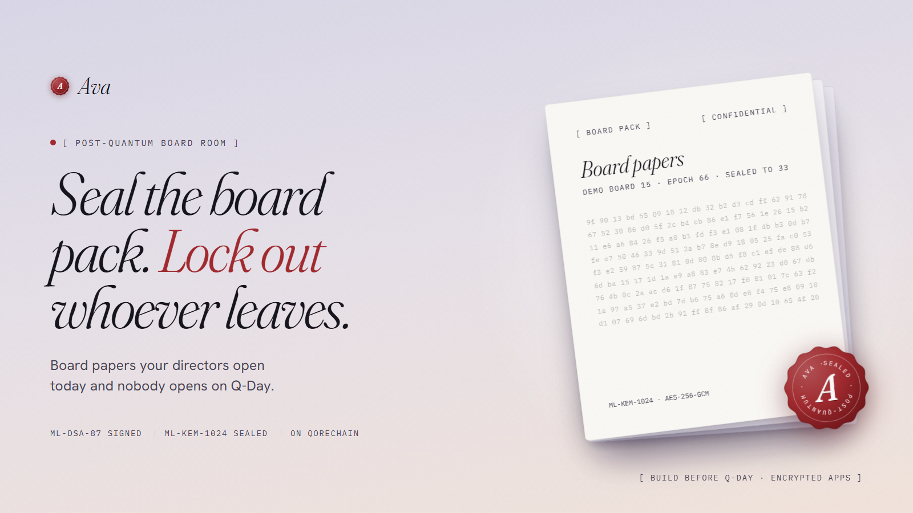
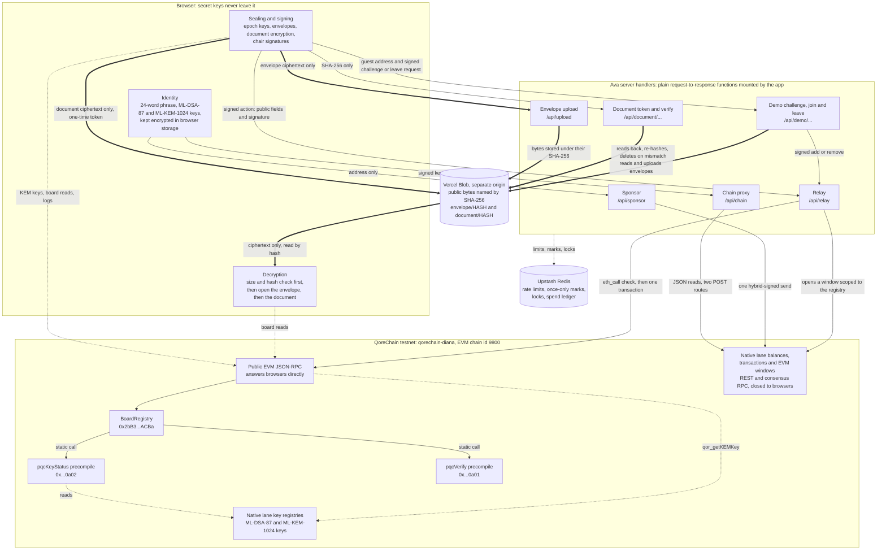
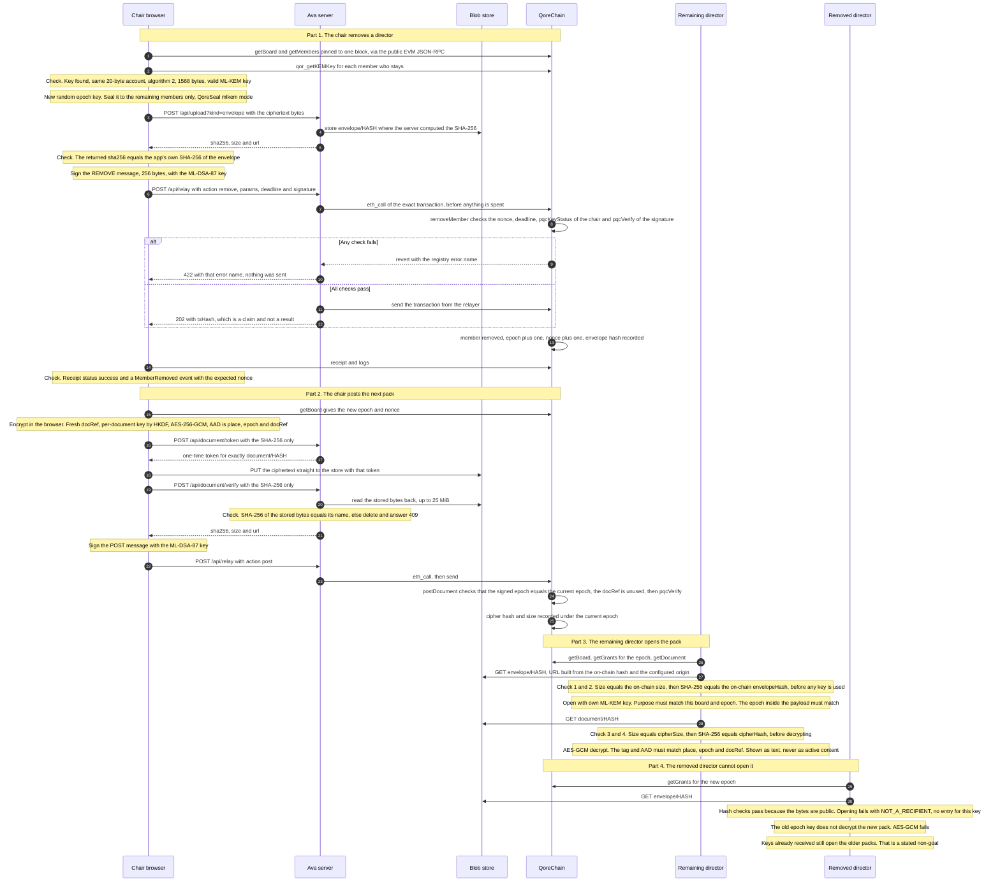
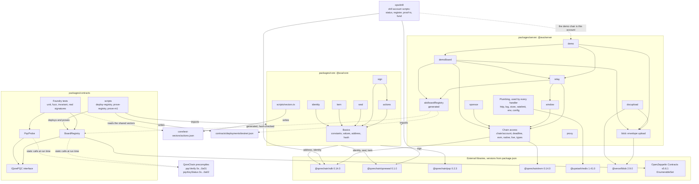

<p align="center">
  
</p>

# Ava

Ava is named after the Tamil word avai (அவை), the assembly where a council meets.

**Board packs your directors can open today and nobody can open on Q-Day, and a director you remove is locked out of the next one.**



[Project page](https://build.qorechain.io/p/ava) · [Docs](packages/web/content/docs/index.mdx) · [Architecture](ARCHITECTURE.md) · [Threat model](docs/security/threat-model.md) · [Live attack results](security/results)

[](https://build.qorechain.io/p/ava)

Built during Build Before Q-Day, the QoreChain Developer Fest, in the Encrypted Apps category. Everything runs on the QoreChain testnet, `qorechain-diana`.

Two things you can check for yourself, with no wallet and no test tokens. The ledger shows what a removed director kept: pack by pack, what they could open before and what is shut to them now, each line with the transaction behind it. And your own browser runs the proof: it attacks the demo board as a page loads, and on the demo you leave by your own signature and watch your browser fail to open the next pack with every key it holds.

Judging this? Go straight to [the two-minute judge path](#the-two-minute-judge-path) and to [where each judging criterion shows](#where-each-judging-criterion-shows).

## Live deployments

| What | Where |
|---|---|
| Web app | Not deployed yet. Until it is, it runs on your machine with the commands in [Quick start](#quick-start) |
| BoardRegistry (every board lives in this one contract) | [`0x2bB34f60B29C7bC10f7ECC0B5050329E808DAcBa`](https://explore.qore.network/address/qor19we57c9jn3auzrm7es94q5pjn6qgmt96qe46x0) |
| PqcProbe (the first end-to-end check of the two precompiles) | [`0x624b5C35E3665eB9ade6d75BBbca1218a09E00D1`](https://explore.qore.network/address/qor1vf94cd0rve0tnt0x6admhjsjrzsfuqx3l9zjly) |
| The public demo board | Board 15 in the registry, chaired by our Q-Day Drill account |
| Docs | The `/docs` route of the app; the pages are in [`packages/web/content/docs`](packages/web/content/docs) |

The explorer opens on mainnet. Press **Testnet** in its top bar once and it remembers.

## Overview

A company's board gets its papers as PDFs in email, or through a portal the company has to trust. Two things go wrong.

- A removed director keeps their access until someone remembers to switch it off, and afterwards nobody can show what they could still read.
- Whatever protects those papers today can be recorded today and broken later. A pack about an acquisition is still worth reading in ten years, when a large quantum computer may open what ordinary encryption locked.

Ava is a board room where the pack is encrypted in the chair's browser, its key is sealed to the directors' own post-quantum keys as QoreChain publishes them, and every change to the board is a signature the chain itself checks. Remove a director and the board gets a new key in the same transaction. The next pack is shut to them, and a ledger read from the chain shows what they kept and what they lost.

| | Email or a board portal | Ava |
|---|---|---|
| Who can read a pack | Whoever the server lets in | Only the directors the pack's key was sealed to, with keys that never leave their browsers |
| The operator | Can read everything it stores | Stores ciphertext and holds no key that opens it |
| Removing a director | An admin switches access off, on trust | One transaction removes them and changes the board's key |
| What they could read before | Nobody can show it | A ledger from the chain's own events lists every pack they kept and every pack they lost |
| A copy recorded today | Readable once today's encryption breaks | Sealed with ML-KEM-1024 |
| A stolen admin password or ordinary key | Changes the board | Changes nothing. Every change needs an ML-DSA-87 signature that the contract verifies |
| Proof | The vendor's word | Your own browser runs the attacks against the chain |

Ava does not pretend a removed director forgets what they already read. They keep every pack they could open before, and the ledger says so in plain words.

## Features

### For a chair

- Create a board with no wallet and no setup. The browser makes the identity, a sponsor account pays its first two fees, and a relay pays for each signed change after that.
- Add a director by address. Choose whether they read only packs from now on (the board gets a new key) or this epoch's packs too.
- Post any file up to 25 MB. It is encrypted in the browser; the name travels inside the ciphertext, and the chain records only a hash, a size and a time.
- Remove a director. The seal re-forms around everyone who stays, and the next pack is shut to the one who left.
- Check every key envelope. The board room downloads each envelope the chain recorded and counts its entries against the people it should name, so an extra reader cannot hide.
- Bring the identity back on another device from its 24 recovery words.

### For a director

- Open the board room and see every board that names your address, with whose board it is.
- Open the packs your keys allow. Decryption happens on your device, after the size and hash have been checked against the chain.
- See your own row in the ledger: member, or removed, with what each means for every pack.

### For anyone checking

- `/proof` runs four checks on the demo board from your own browser as the page loads: a change with no ML-DSA-87 signature, sent from the chair's own address and from a stranger's; a replay of the board's newest real change; one real signature tried on five messages, by the chain and by your browser; and the newest pack as we store it, hashed and compared with the chain.
- `/demo` lets a visitor join a real board, open a pack sealed to them, leave by their own signature, and watch their own browser fail to open the next pack with every key it holds.
- Nothing on any screen is typed in. Every number comes from the chain or from the visitor's own browser.

### For the Q-Day Drill

- The demo board's chair is the account we entered in the fest's Q-Day Drill. Its ordinary ECDSA key was handed to the organisers' attacker on 18 November 2026. No board changed, because the registry accepts only the chair's ML-DSA-87 signature.

## Testnet deployment

Network: `qorechain-diana`, EVM chain id 9800.

| Contract | EVM address | Native address | Deployed |
|---|---|---|---|
| BoardRegistry | `0x2bB34f60B29C7bC10f7ECC0B5050329E808DAcBa` | [`qor19we57c9jn3auzrm7es94q5pjn6qgmt96qe46x0`](https://explore.qore.network/address/qor19we57c9jn3auzrm7es94q5pjn6qgmt96qe46x0) | Block 10,235,963, [deployment transaction](https://explore.qore.network/tx/BF969C6F71ACBDD4F4085F81E73E01E4A9B49A33D52893B8DB60E2157958D0AE) |
| PqcProbe | `0x624b5C35E3665eB9ade6d75BBbca1218a09E00D1` | [`qor1vf94cd0rve0tnt0x6admhjsjrzsfuqx3l9zjly`](https://explore.qore.network/address/qor1vf94cd0rve0tnt0x6admhjsjrzsfuqx3l9zjly) | Block 10,181,860 |

The registry has no owner, no admin, no pause and no upgrade path, and it accepts no value.

### Checking the code

The explorer has no source verification, so the check is the code itself. Compiler: Solidity `0.8.38+commit.1835d247`, EVM version `prague`, optimizer on, 200 runs ([`foundry.toml`](packages/contracts/foundry.toml)). Both commands print the same hash:

```bash
cd packages/contracts
cast code 0x2bB34f60B29C7bC10f7ECC0B5050329E808DAcBa --rpc-url https://evm-testnet.qore.host | cast keccak
forge inspect BoardRegistry deployedBytecode | cast keccak
# 0x157b97bfe8fdc2477a2326a26cee20683bf25ca44a96f98ee5c233745f844a9b
```

### Real transactions

One board's whole life, run from the web app on 23 November 2026 (board 47), and the drill account's records. The explorer finds a transaction by its native hash; the EVM hash is what the registry's events carry.

| What happened | On the explorer | EVM hash |
|---|---|---|
| A chair created board 47 | [`FF70F18D...0CA741`](https://explore.qore.network/tx/FF70F18DD194D725506D01C53EC621DD307E8B145D509EB972229DE0C20CA741) | `0x2543e3fc748a66be8d8fb47df8d6272ee7e5d6819fae848c3edf8bb9bc298c98` |
| Pack 1 posted, 132 bytes of ciphertext | [`933EBF4A...6B0F30`](https://explore.qore.network/tx/933EBF4AD4A33566EE7A61E4EDAD7070B95C1D0911E9018F47B9B841706B0F30) | `0x8f744d14397dc5bd2982e3664167cf7952460905f5c9df5bf724f7dc1cafdcb3` |
| A director added, with the current key sealed to them | [`BC816397...8A4B58`](https://explore.qore.network/tx/BC8163972560B5E7466D334E5B7F925F4887A14EEEFB69CAF3DBA98E988A4B58) | `0xabc0e44b9be7e1e2f943fd3b1d4faf3f2616120470a29ec733e6d9aeda230363` |
| The director removed and the key changed, in one transaction | [`B6EE53F1...E6D3DD`](https://explore.qore.network/tx/B6EE53F17C9CA2C50A7D48A79CD9BBE390C6E9748FF762A5872C3B5925E6D3DD) | `0x0f84b27a9fc8d68ac2ae91b81cc6cfb8e02deb8e92fcc658735feb75c9682a96` |
| Pack 4 posted after the removal, shut to them | [`CDFF5FF4...6BB179`](https://explore.qore.network/tx/CDFF5FF44807FEDFC8E87BF1F89C05414433B79A8C1CAEDE243D9B17076BB179) | `0x151746a27cd051d5efbfc139bb0f7ee8908589dbbca8a8c7a72439120349884a` |
| The demo chair's ML-DSA-87 key registered, with proof of possession | [`E4D259EC...73F10B`](https://explore.qore.network/tx/E4D259ECAF0FAED3CB08F83554CF36E4029DFB4F6538D925B28CE602F873F10B) | native transaction |
| The demo chair's ML-KEM-1024 key registered | [`2A0159E6...8DCC39`](https://explore.qore.network/tx/2A0159E668415DB3FC7491FDC2426FF53506A56F3452657DC35707954B8DCC39) | native transaction |
| Our Q-Day Drill proof transaction, 18 November | [`85C35B4A...023773`](https://explore.qore.network/tx/85C35B4A0E804D5385719D795EB383E5D0EBB974FD1A49B18A6AE8B112023773) | native transaction |

## Where each judging criterion shows

The fest's FAQ gives the same five criteria for every category.

| Criterion | Where to look |
|---|---|
| Works as described, 25% | [The two-minute judge path](#the-two-minute-judge-path). A production build was walked end to end on testnet on 23 November: board 47 above |
| QoreChain tech usage, verified in the repo and on chain, 25% | The requirements table below, each with its code and a real transaction |
| Post-quantum correctness and security, 20% | [Security](#security): a threat model written before the code, 77 live attacks, a randomised test of timing and order, the Q-Day Drill |
| Originality, 15% | A ledger that admits what a removed director kept. A visitor who leaves by their own signature and watches their own browser fail. Attacks the visitor's browser runs |
| Clarity, UX and documentation, 15% | No wallet and no setup for a judge. Docs inside the app at `/docs`. This README, [ARCHITECTURE.md](ARCHITECTURE.md) and two byte-level specs in [`docs/spec`](docs/spec) |

The Encrypted Apps requirements, and the two Solidity features the project page says are checked by hand:

| Requirement | In the code | On chain |
|---|---|---|
| ML-KEM-1024 encryption | [`packages/core/src/seal.ts`](packages/core/src/seal.ts) `sealEpochKey` seals each board key with QoreSeal, mode `mlkem`, never anonymous | Every board change that grants a key emits `EnvelopeGranted` with the envelope's SHA-256, as in the creation of board 47 above |
| Registered recipient keys | [`packages/core/src/kem.ts`](packages/core/src/kem.ts) `fetchKemKey` reads each director's key from QoreChain's registry with `qor_getKEMKey` on the public EVM endpoint. Ava's server is never asked whose key is whose | The ML-KEM-1024 registration above |
| ML-DSA key binding | [`BoardRegistry.sol`, lines 688 to 733](packages/contracts/src/BoardRegistry.sol#L688-L733): `_provenKey` requires a registered ML-DSA-87 key with possession proven, and `_authorise` checks the signature over the message the contract builds itself | The removal above was accepted only because of it |
| Client-side encryption and decryption | [`packages/web/lib/chair/board.ts`](packages/web/lib/chair/board.ts) `postPack` and `openPack` run in the browser and call `encryptDocument` and `decryptDocument` from `seal.ts`. The server handles ciphertext only | Each `DocumentPosted` carries the ciphertext's hash and size, as in pack 1 above |
| Solidity PQC key status | `_provenKey` calls the `pqcKeyStatus` precompile at `0x0000000000000000000000000000000000000a02` | Every write to the registry |
| Solidity PQC signature check | `_verify` calls the `pqcVerify` precompile at `0x0000000000000000000000000000000000000a01` | Every write to the registry |
| Key rotation and earlier data (Workshop 3) | `removeMember` removes and rotates in one transaction. [`packages/web/lib/boardRules.ts`](packages/web/lib/boardRules.ts) works out who can open which pack from epochs, never from dates | The removal and pack 4 above |

## Architecture

The full description is in [ARCHITECTURE.md](ARCHITECTURE.md). Its three diagrams:

### What runs where

Secrets stay in the browser, ciphertext travels on the thick arrows, and the chain checks every signature.



### The main sequence



### The pieces and what depends on what



## The two-minute judge path

No wallet, no test tokens and no install. Steps 1 and 2 take about two minutes. Step 3 adds about ninety seconds of waiting for blocks.

1. Open `/proof`. As the page loads, your browser runs four checks against the chain and shows each answer. A change with no ML-DSA-87 signature, sent from the chair's own address and from a stranger's: both `REFUSED · BADSIGNATURE`. The board's newest real change, sent again byte for byte: `REFUSED`, with the registry's own reason. One real signature tried on five messages: the chain and your browser agree, valid once and never again. The newest pack as we store it, hashed in your browser: `SAME` as the hash on chain. About ten seconds.
2. Open `/demo`. Type any passphrase of ten characters or more and press **Make my identity and join**. Six chapters run on screen: your identity is made, funded, its two keys go on chain, you sign the chair's challenge, you are admitted, and a pack sealed to you opens on your device. About seventy seconds.
3. Press **Leave the board**. Your browser signs your own removal, the board gets a new key, and the next pack is posted. Your browser then tries every key it holds on that pack and shows that none opens it.
4. Open `/board` to run a board of your own: create it, add a director by address, post any file, remove the director, and read the ledger.

From a terminal instead, with no account and no secret. The attack suite uses the shared library and the server package, so those two are installed first:

```bash
git clone https://github.com/ramakrishnanhulk20/ava
cd ava/packages/core && npm install
cd ../server && npm install
cd ../../security && npm install
npx tsx run.ts --offline
# ...
# 4 of 4 offline attacks held.
```

With a funded testnet account in `packages/contracts/.env` (the [faucet](https://docs.qorechain.io/dashboard/faucet) gives test QOR; `npm run new-deployer` makes the account and `npm run register-deployer` registers its keys):

```bash
cd packages/contracts && npm install
npm run install:forge-std && npm run install:oz
npm run prove:registry
```

It walks a real board through its life on testnet and attacks it at every step. The saved run in [`packages/contracts/deployments`](packages/contracts/deployments) ends like this:

```
8. Summary
  1. OK      Chain and registry
  2. OK      Identities: chair, Dana, Eli
  3. OK      The chair creates a board (3a), and a second one for attack 7e (3b)
  4. OK      The chair adds Dana (MODE_ROTATE), then Eli (MODE_SEAL_CURRENT)
  5. OK      The chair posts document 1 under epoch 1; Dana and Eli decrypt it
  6. OK      The chair removes Eli and posts document 2 under epoch 2
  7. OK      Attacks, each refused
  result:   every step OK
```

## Quick start

Node.js 22.13 or newer. The repository is four packages, installed one by one in this order, because the later ones use the earlier ones.

```bash
git clone https://github.com/ramakrishnanhulk20/ava
cd ava/packages/core && npm install && npm test
cd ../server && npm install && npm test
cd ../web && npm install && npm test
```

The contract tests need [Foundry](https://getfoundry.sh):

```bash
cd ../contracts && npm install
npm run install:forge-std && npm run install:oz
forge test
```

### Run the site

The front page, `/proof` and `/docs` read the live chain and need no secret:

```bash
cd packages/web
cp .env.example .env.local
npm run dev
# http://localhost:3000
```

### Run the whole thing

Joining the demo board, creating a board and posting packs go through the server handlers, which need their own stores and accounts. Each value is described where it is set, in [`packages/server/.env.example`](packages/server/.env.example); `packages/web/.env.local` takes the same values.

| You need | How to get it |
|---|---|
| A shared counter store | A free Redis database at [upstash.com](https://upstash.com). Copy its REST URL and REST token |
| A blob store with public access | A Vercel Blob store. Copy its read-write token and its public origin. Ciphertext is public by design |
| A relayer account, which pays for signed changes | In `packages/server`: `npm run new-relayer`, send it test QOR from the [faucet](https://docs.qorechain.io/dashboard/faucet), then `npm run register-relayer` |
| A sponsor account, which funds each new identity once | `npx tsx scripts/new-sponsor.ts`, fund it, then `npx tsx scripts/register-sponsor.ts` |
| A demo board, only for `/demo` | `npx tsx scripts/seed-demo-board.ts` with a funded chair account in `DEMO_CHAIR_MNEMONIC` |

No script prints a recovery phrase. Each writes it straight into the `.env` file.

## Using the shared library

`packages/core` is the one library every part of Ava uses, and it works on its own. Signing a removal, exactly as the web app does:

```ts
import { Action, deadlineFrom, fetchKemKey, newEpochKey, sealEpochKey, sha256, signBoardAction } from "@ava/core";

// Who stays on the board, with their ML-KEM-1024 keys read from QoreChain's registry.
const recipients = await Promise.all(staying.map((address) => fetchKemKey(address)));

// A fresh key for the next epoch, sealed to them and to nobody else.
const envelope = sealEpochKey({ registry, boardRef, epoch: epoch + 1n, epochKey: newEpochKey(), recipients });

// The 256 bytes the contract will build for itself, signed with the chair's ML-DSA-87 key.
const { signature } = signBoardAction(chairSecretKey, {
  action: Action.REMOVE,
  member: leaving,
  envelopeHash: sha256(envelope),
  envelopeSize: envelope.length,
  epochAfter: epoch + 1n,
  registry,
  boardId,
  nonce,
  deadline: deadlineFrom(latestBlockTimestamp, 600),
  latestBlockTimestamp,
});
```

Anyone may submit the result to `removeMember`. The sender gains nothing by it.

### A pqcVerify test double for Foundry

QoreChain's two precompiles do not exist on a local test chain. [`packages/contracts/test/helpers/PqcTestKit.sol`](packages/contracts/test/helpers/PqcTestKit.sol) and the three contracts in [`test/mocks`](packages/contracts/test/mocks) stand in for them at their real addresses. Copy the four files, inherit `PqcTestKit`, and call `_etchPqcMocks()` in `setUp`. [`BoardRegistryRealSig.t.sol`](packages/contracts/test/BoardRegistryRealSig.t.sol) then shows how to pair the double with real ML-DSA-87 signatures.

## Contract and API reference

### BoardRegistry: signed changes

Each takes a deadline and the chair's 4,627-byte ML-DSA-87 signature as its last two arguments. The exact signed bytes are in [`docs/spec/actions.md`](docs/spec/actions.md).

| Function | What it does | Emits |
|---|---|---|
| `createBoard` | Makes a board chaired by the signer, with its first key envelope | `BoardCreated`, `EnvelopeGranted` |
| `addMember` | Adds a director, to the current epoch or by starting a new one | `MemberAdded`, `EnvelopeGranted`, and `EpochRotated` for a new epoch |
| `removeMember` | Removes a director and starts a new epoch in the same step | `MemberRemoved`, `EpochRotated`, `EnvelopeGranted` |
| `rotateEpoch` | Starts a new epoch with the same members | `EpochRotated`, `EnvelopeGranted` |
| `postDocument` | Records a pack's reference, hash and size in the current epoch | `DocumentPosted` |
| `transferChair` | Hands the board to another member | `ChairTransferred` |

### BoardRegistry: reads

`getBoard`, `getMembers`, `isMember`, `getGrants`, `getDocument`, `exists`, `boardIdOf`, and the pure builders `actionMessage` and `paramsCreate` to `paramsTransfer`, which return the bytes a signature must cover.

### Limits

64 members a board, 110,000 bytes a key envelope, 25 MiB a pack, and a signature's deadline at most one hour after the latest block.

### Server routes

All are in [`packages/server`](packages/server/src) and mounted by the web app under `/api`. None of them can read a pack or change a board.

| Route | Job |
|---|---|
| `POST /api/relay` | Checks a signed change by simulating the exact transaction, then submits it and pays the fee |
| `POST /api/sponsor` | Sends a new identity the test QOR for its two key registrations, once |
| `POST /api/upload?kind=envelope` | Stores a key envelope under the SHA-256 of the bytes it received |
| `POST /api/document/token`, `POST /api/document/verify` | Issues a one-time token for one pack's hash and size, then reads the stored bytes back and re-hashes them |
| `GET` and `POST /api/chain/...` | A narrow proxy to the chain's REST for the few native reads and the two key registrations a browser cannot send directly |
| `POST /api/demo/challenge`, `/api/demo/join`, `/api/demo/leave/challenge`, `/api/demo/leave` | The demo board's bot: admits a guest who signs its challenge, and removes a guest who signs a leave request |

Request and response shapes are in [ARCHITECTURE.md, section 6](ARCHITECTURE.md#6-the-interface-for-the-web-app).

## Tests

Real output, 23 November 2026.

```
$ forge test                          # packages/contracts
Ran 5 test suites in 34.45s (36.74s CPU time): 139 tests passed, 0 failed, 0 skipped (139 total tests)

$ npm test                            # packages/core
 Test Files  5 passed (5)
      Tests  80 passed (80)

$ npm test                            # packages/server
 Test Files  13 passed (13)
      Tests  320 passed (320)

$ npm test                            # packages/web
 Test Files  14 passed (14)
      Tests  135 passed (135)

$ python packages/core/crosscheck/check_actions.py
27 of 27 checks passed: 6 actions, the challenge and the leave request rebuilt byte for byte from the spec.

$ npx tsx run.ts --offline            # security
4 of 4 offline attacks held.

$ npx tsx run.ts                      # security, against the live testnet, 52 minutes
Result: 76 of 77 held, 1 not run, 0 not held
```

- The contract suite includes fuzz and invariant tests, and `FOUNDRY_PROFILE=realsig forge test` runs five tests with real ML-DSA-87 signatures.
- The signed bytes are built three times from one spec: by the TypeScript library, by the Solidity contract, and by [`check_actions.py`](packages/core/crosscheck/check_actions.py), a Python script with its own Keccak-256 that shares no code with either. All three agree on every vector.
- The server suite includes a randomised test that plays sequences of joins, leaves, posts, retries and lost replies and checks 18 promises after every step. A deep run of 2,000 sequences held all 18. To check that the test can fail, 18 bugs were planted in the code one at a time, and it caught every one.
- The one attack not run is `C36-drill-key`. It needs the key the drill's organisers publish, and until it has run it is not counted as passed.

## What a change costs

Measured on testnet on 17 November 2026. On the site the relay pays these for you, within a daily budget of 20 test QOR for everyone together.

| Change | Gas used | Fee |
|---|---|---|
| Create a board | 416,878 | about 0.047 QOR |
| Add a director with a new key | 359,156 | about 0.040 QOR |
| Add a director with the current key | 322,961 | about 0.036 QOR |
| Remove a director | 291,584 | about 0.033 QOR |
| Post a pack | 309,501 to 326,553 | about 0.036 QOR |

Each change carries a 4,627-byte ML-DSA-87 signature that the chain verifies before anything is stored. The sponsor account sends each new identity 0.25 test QOR once, which covers its two key registrations.

## Project structure

```
packages/
  core/        the shared library: signed bytes, addresses, hashing, sealing, pack encryption
  contracts/   BoardRegistry, PqcProbe, the Foundry tests, the deploy and prove scripts
  server/      the handlers: relay, sponsor, uploads, chain proxy, demo bot, and their tests
  web/         the Next.js app: the screens, the /api routes, the docs under content/docs
security/      one live attack for each promise in the threat model, and every run's results
ops/drill/     the scripts for the account entered in the Q-Day Drill
docs/
  security/    the threat model and the runbook
  spec/        the exact bytes of a signed action and of an encrypted pack
ARCHITECTURE.md
```

## Tech stack

| Layer | What |
|---|---|
| QoreChain | `pqcVerify` and `pqcKeyStatus` precompiles, the ML-DSA-87 and ML-KEM-1024 key registries, scoped EVM windows, hybrid transactions |
| QoreChain kits | QoreChain SDK 0.14.0 (`@qorechain/sdk`, `@qorechain/evm`), QoreSeal 0.1.0, qorechain-pqc 0.2.3, and QoreSign 0.1.0, which QoreSeal builds on |
| Contracts | Solidity 0.8.38, Foundry with forge-std 1.17.0, OpenZeppelin Contracts 5.6.1 (EnumerableSet) |
| Shared library and server | TypeScript 7, viem 2.57, CosmJS 0.39, zod 4, Upstash Redis client, Vercel Blob client |
| Web app | Next.js 16, React 19, Tailwind CSS 4, Motion, Lenis, Fumadocs with Base UI |
| Tests | Foundry, Vitest 5, fast-check 4 |
| Type | Fraunces, Hanken Grotesk and IBM Plex Mono, each under the SIL Open Font Licence |

## Security

The [threat model](docs/security/threat-model.md) was written before any contract code. It has 47 numbered rules, and each one names the code that upholds it, the test or live attack that proves it, and what it does not cover.

- In the browser, recovery words are stored only encrypted under the passphrase. The browser signs only messages it built itself, believes a change only after reading the chain's own event for it, and reads directors' keys from the chain, never from Ava's server.
- Every page is served with a Content-Security-Policy built around a one-time code. A decrypted pack is never shown as a web page: text is shown as text, an image in a locked frame, and everything else is a download.
- On the server, the relay simulates the exact transaction before paying for it, spends within daily limits, and keeps a narrow, self-closing window on its own account. It holds no key that reads a pack or signs for a board.
- The [attack suite](security) has one attack for each promise and runs against the deployed registry and our own server. Every run is saved in [`security/results`](security/results).

What Ava does not defend against, in short: a member who shares what they read, packs a removed director could already open, a compromised device, a weak passphrase, lost recovery words, and a takeover of the deployment that serves the page. The full list is in the docs' Security page, [`security.mdx`](packages/web/content/docs/security.mdx).

Ava runs on a testnet that can be reset, and it has had no outside audit.

## Licence

[MIT](LICENSE).

## Acknowledgments

Ava exists because QoreChain has three things built into the chain: a registry of ML-KEM-1024 keys to seal to, registered ML-DSA-87 keys with proof of possession, and precompiles that let a Solidity contract check an ML-DSA-87 signature. Without the third, a server would have to be trusted to check signatures, and removing a director would be a promise instead of a fact.

- QoreChain kits: [QoreSeal](https://docs.qorechain.io/developer-tools/qoreseal) for the envelopes, the QoreChain SDK for accounts and hybrid transactions, qorechain-pqc for ML-DSA-87, and QoreSign, which QoreSeal builds on. Docs: https://docs.qorechain.io
- Open source: viem, CosmJS, zod, Foundry and forge-std, OpenZeppelin Contracts, Next.js, React, Tailwind CSS, Motion, Lenis, Fumadocs, Base UI, Vitest and fast-check.
- Services: Upstash Redis for shared counters and Vercel Blob for ciphertext.
- The fest: the Q-Day Drill, which made us treat the chair's ML-DSA-87 key as the whole account, because it is.
